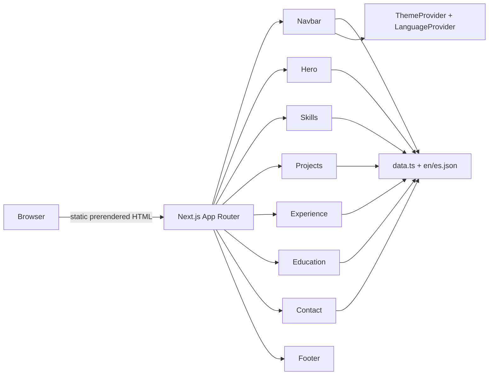

# Uriel Ortiz — Developer portfolio

A bilingual (English/Spanish) personal portfolio and résumé site built with Next.js. It shows the author's profile, skills, featured projects, work history, education and contact info, and serves a downloadable CV.

## What this is

A single page, fully static React app. All content is data driven: text lives in translation dictionaries and structured modules, and presentational components render it. It switches between English and Spanish, and between light and dark themes, without flashing the wrong theme on load.

## Features

- Full English/Spanish switching. The language preference is saved in localStorage.
- Light and dark themes built on CSS custom properties, applied before first paint so there's no flash.
- A sticky, scroll aware navbar with an animated mobile menu.
- A hero section with profile stats and an "about" card.
- Filterable skills: category tabs with an animated indicator and grouped chips.
- Featured projects as cards that link out to each project's repo, and to the live URL when there is one.
- An experience timeline with role and responsibility bullets.
- Education, certifications and languages.
- A contact section that copies email or phone to the clipboard with one click, plus a GitHub link.
- Scroll reveal animations done with IntersectionObserver.
- A downloadable CV served from public/.
- SEO and OpenGraph metadata in the App Router layout.
- Responsive layout and ARIA labels on interactive controls.

## How it's put together

The production build prerenders the single route to static HTML. There is no backend, API or database.

```
page.tsx  →  layout.tsx (providers)  →  section components  →  data + dictionaries
```

- Providers: LanguageProvider (EN/ES context) and ThemeProvider (dark/light context) wrap the page in layout.tsx.
- Components: section components (Hero, Skills, Projects, Experience, Education, Contact, Navbar, Footer) plus reusable primitives (Reveal, SectionHeading, ProjectCard, ThemeToggle, LanguageToggle).
- Data: profile, skills, projects, experience and education live in src/lib/data.ts. All visible text lives in src/i18n/locales/{en,es}.json.
- Theming: CSS custom properties defined in src/app/globals.css, mapped into Tailwind via @theme.



## Tech stack

- Framework: Next.js 16.4.1 (App Router, Turbopack build)
- UI: React 19.2.8
- Language: TypeScript 5 (strict)
- Styling: Tailwind CSS 4 (@tailwindcss/postcss)
- Linting: ESLint (eslint-config-next core-web-vitals + typescript)
- Fonts: Geist / Geist Mono via next/font

No backend, database, API routes or server side data fetching. The app is fully static.

## Project structure

```
portfolio/
├── src/
│   ├── app/
│   │   ├── layout.tsx        # Root layout: providers, fonts, metadata
│   │   ├── page.tsx          # Single page assembling all sections
│   │   ├── globals.css       # Tailwind, CSS variables, theme tokens
│   │   └── favicon.ico
│   ├── components/           # Section + reusable UI components
│   ├── i18n/
│   │   ├── LanguageProvider.tsx
│   │   └── locales/{en,es}.json
│   ├── lib/data.ts           # Profile, skills, projects, experience, education
│   └── theme/ThemeProvider.tsx
├── public/
│   ├── Uriel_Ortiz_Rosales.pdf
│   └── Uriel_Ortiz_Rosales_EN.pdf
├── .github/workflows/deploy-pages.yml
├── next.config.ts
├── tsconfig.json
├── postcss.config.mjs
├── eslint.config.mjs
└── package.json
```

## Getting started

### Prerequisites

- Node.js 24 (the version used in CI)
- npm

### Install and run

```bash
npm ci
npm run dev
```

Open http://localhost:3000.

### Production build

```bash
npm run build      # type-checks and builds the static bundle
```

Serve the generated `out/` directory with a static HTTP server to preview production. Do not use `npm start` / `next start`: this project uses static export, not a Next.js production server.

## Configuration

No environment variables. The app runs without configuration. TypeScript path aliases (@/* → ./src/*) are set in tsconfig.json.

## Testing

There are no unit or browser tests yet. Run the same validation gates as CI:

```bash
npm run lint
npx next typegen && npx tsc --noEmit
npm audit --omit=dev --audit-level=high
npm run build
```

## Deployment

Production runs at https://urielortiz.xyz/ on GitHub Pages. `next.config.ts` sets `output: "export"`; only the generated `out/` directory is published. The custom domain serves the site at `/`, so no repository base path is configured.

The workflow in `.github/workflows/deploy-pages.yml` validates pull requests with lint, TypeScript, a production dependency audit, and a static build. Pull requests cannot deploy. After merging into `main`, the workflow repeats validation, checks the exported HTML and both CVs, uploads the artifact, and deploys through the `github-pages` environment. Actions are pinned by SHA; deployment permissions are scoped to the deploy job, with explicit timeouts.

Repository setup: Pages source must be **GitHub Actions**, the custom domain must be `urielortiz.xyz`, HTTPS enforcement must remain enabled, and the `github-pages` environment must allow only `main`. DNS and certificate management stay in GitHub Pages/domain settings, not build-time environment variables.

For a manual redeploy, run **Deploy to GitHub Pages** from the Actions tab on `main`. To roll back, revert the offending change through a pull request; merging it rebuilds and deploys the reverted source. Do not rewrite `main` or upload local build output to Git.

## Security

- The static site does not require secrets, API keys, tokens or credentials.
- No environment variables, so there's no .env to leak.
- Fully static: no backend, database or API surface.
- Contact details (email and phone) are public on purpose; it's a portfolio site.
- Both CV PDFs in public/ are intentionally available for download.
- Production dependencies pass `npm audit --omit=dev`. The full audit still reports GHSA-vfj7-8cjw-p6xm in the ESLint-only `braces` dependency chain; no patched `braces` version is available at the time of this update. This tooling is not shipped in the static site. Do not apply the suggested forced downgrade to Next.js 14 tooling; reassess when an upstream fix becomes available.

## What's left

- Unit tests (Vitest) and end to end tests (Playwright).
- A real contact form backed by a serverless function or third party service.
- Individual project detail pages or dynamic routing.


## License

MIT. See LICENSE.

## Author

Uriel Ezequiel Ortiz Rosales, Aguascalientes, Mexico.
